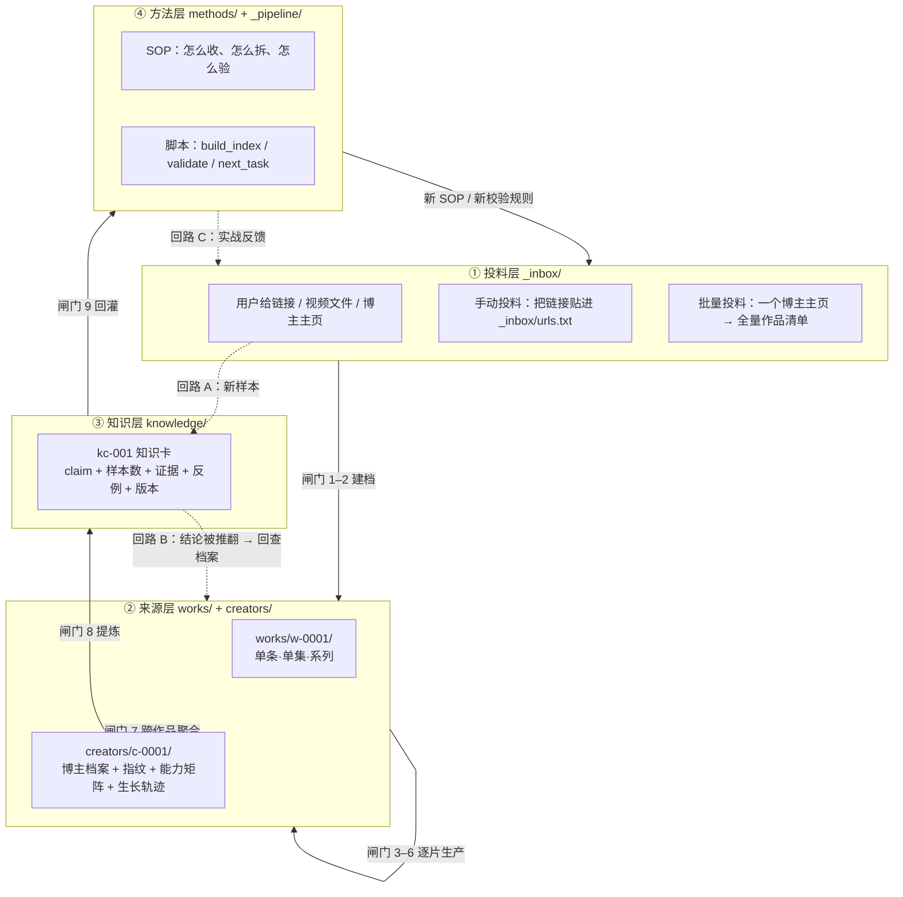
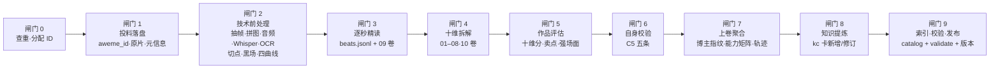
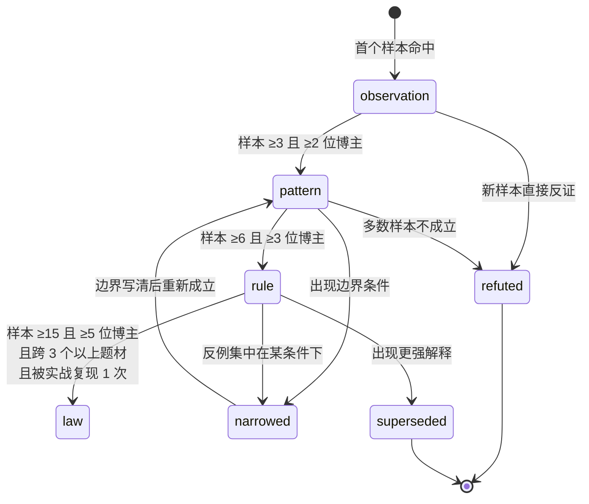
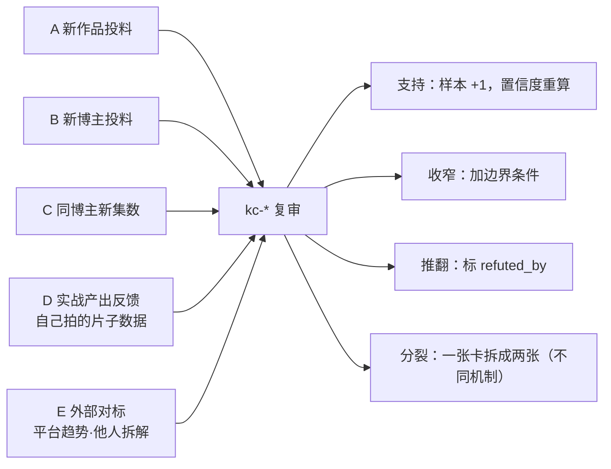
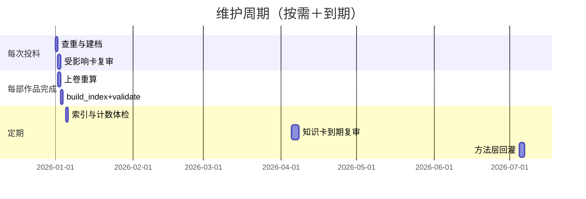

# FLOW.md · 全流程图（投料 → 生产 → 生长 → 维护）

> 这个库不是"拆完就完"的档案柜。它是一条**流水线**：用户投一条链接，库长出一片档案；档案攒够样本，长出知识卡；新样本进来，知识卡被支持、收窄或推翻。
>
> 本页是所有流程的**唯一图源**。改流程先改这里，再改 `methods/` 与 `_pipeline/`。

---

## 0. 一张图看懂：库的四层与三条回路

**三条回路是"生长"的全部含义**：

| 回路 | 触发 | 发生什么 | 不允许什么 |
|---|---|---|---|
| **A 新样本** | 新作品入库 | 所有相关 `kc-*` 强制复审：支持 / 削弱 / 无影响，写进 `revisions` | 不许装没看见，不许只加样本不复查旧结论 |
| **B 结论推翻** | 新样本与旧卡冲突 | 旧卡降级或标 `superseded_by`，回查所有引用它的档案页 | 不许直接删卡，不许静默改 claim |
| **C 实战反馈** | 用本库方法做出片子、发了、有数据 | 反馈写 `reports/feedback-*.md`，反向修 `methods/` 与 `kc-*` | 不许把"我觉得"当实测数据 |

---

## 1. 单条作品：九道闸门（生产流水线）

| # | 闸门 | 输入 | 动作 | 通过条件（硬） | 产物 |
|---|---|---|---|---|---|
| 0 | 查重 | 链接 / 文件名 | 用 `aweme_id` 查 `works/index.jsonl`；无 ID 时用「博主名+标题+时长」三元组兜底 | 无重复；`w-NNNN` 已分配且不复用 | `works/w-NNNN/` |
| 1 | 投料 | 抖音链接 | 解析短链 → `aweme_id`；下载无水印原片；抓作者/时长/发布时间/互动/话题/音乐 | 原片 sha256 记录；元信息缺项写 `null` 不猜 | `raw.json` `meta.json` |
| 2 | 前处理 | 原片 | `prep.py`：ffprobe → 1fps 抽帧 → 2×2 拼图 → scdet 切点 → 帧差 → 四曲线 →（`--ocr`）RapidOCR 三区；音轨分离与 Whisper 另跑 | 帧数 = ⌈时长⌉；拼图覆盖全部帧；`data/meta_raw.json` 与 `cuts.txt` 在 | `data/*.json` `frames/` `contact/` |
| 3 | 逐秒精读 | 帧 + 拼图 | 逐格亲读，登记画面/字幕/对白/声音/功能；冲突处 5–7× 放大定字；**05 卷表回填**用 `text05.py` 拆进 `sub`/`screen` | **每一秒都有登记**；字幕逐字，OCR/Whisper 仅交叉验证；不可确认标「不可确认」；05 卷有权威表的部必须回填 | `beats.jsonl` + `09_画面实录.md` |
| 4 | 十维拆解 | beats + 四曲线 | 钩子 / 结构 / 人物 / 视听 / 表演 / 声音 / 文字 / 剪辑 / 情绪 / 传播 逐维写 | 每条结论回指秒号；量化指标带口径 | `01–08·10 卷` |
| 5 | 评估 | 十维卷 | 十维打分 + 六类卖点 + 强场面 Top5 + 可迁移清单 | 每分有证据；不合成单一总分 | `assessment.md` |
| 6 | 自校验 | 全部卷 | C5：秒列单调 / 05↔09 可回溯 / 跨卷锚点 / 拼图连续 / srt↔05 双含 | **0 error**；WARN 逐条说明 | `reports/c5-w-NNNN.md` |
| 7 | 上卷 | 该博主全部作品 | 重算指纹、能力矩阵、生长轨迹、系列引擎 | 指纹每条 ≥2 部作品支撑，否则标「单部观察」 | `creators/c-NNNN/*` |
| 8 | 提炼 | 全库 beats + 评估 | 新增/修订/收窄/推翻 `kc-*` | 每卡有 claim、样本数、证据、反例、边界、revisions | `knowledge/kc-*.md` |
| 9 | 发布 | 全部 | `build_index` → `validate` → 同步版本号与计数 | validate 0 error；索引非过期 | `catalog/*.json` `MANIFEST.json` |

**闸门 3 是全库的地基**：`beats.jsonl` 一行 = 一个 4 秒格，是后面所有知识卡的最小证据单位。这一层错了，上面全错。

---

## 2. 知识卡：从一条观察到一条规律（生长状态机）

| 成熟度 | 门槛 | 允许的措辞 | 能否进方法层 |
|---|---|---|---|
| `observation` 观察 | **单博主**（cc=1），样本量不限 | n=1：「单部观察，不足以判断」 n≥2：「单博主观察，未见其他博主印证」 | ✗ |
| `pattern` 模式 | n≥3 且 ≥2 博主 | 「较可能…，基于 N 部 / M 位博主」 | 仅作参考 |
| `rule` 规律 | n≥6 且 ≥3 博主 | 「可以确认…（N 样本 / M 博主）」 | ✓ 可写成 SOP 条目 |
| `law` 定律 | n≥15、≥5 博主、≥3 题材、实战复现 | 「稳定成立，边界为…」 | ✓ 可固化为模板/默认参数 |

> **成熟度的本质是跨博主验证，不是样本量。**
> 一个博主拆 19 部，证明的是「他的作者指纹」，那是 `creators/<id>/fingerprint.md` 的事，不是知识卡。
> 知识卡要回答的是「换个博主还成不成立」，所以 `creator_count` 才是硬门槛，`sample_size` 只是辅助。
> （2026-10-30 修正：旧门槛把 observation 限在 n≤2，导致「单博主 3 部」既超上限又够不上 pattern 的 2 位博主，无路可走。）

**升级不许跳级**，也不许"因为博主多所以升版"——门槛按**独立作品数**算，同一系列 8 集只算 1 部（连续性作品），番外/花絮不计入。

**降级与推翻**：

- `narrowed`：原 claim 仍成立但需加条件 → 改 `claim` 加边界，`narrowed_to` 写清
- `refuted`：多数反例 → `refuted_by` 列反例 ID，卡保留但退出导航
- `superseded`：有更强解释 → 新卡 `supersedes` 旧卡，旧卡 `superseded_by` 指向新卡
- **一律不删**。删掉等于让下一个人再踩一遍。

---

## 3. 知识生长的五个入口（不是只有"加样本"）

| 入口 | 谁能触发 | 强制动作 |
|---|---|---|
| A 新作品 | 任何投料 | 跑 `next_task` → 列出受影响卡 → 逐张判断 |
| B 新博主 | 新 `c-NNNN` | 作者层结论（指纹）必须重算，不许沿用旧的 |
| C 同博主新集 | 系列续集 | 系列引擎卡的 `sample_size` 按"系列"计 1，不按集数灌水 |
| D 实战反馈 | 自己的片子 | 写 `reports/feedback-*.md`，含数据；无数据只能写"主观反馈" |
| E 外部对标 | 人工 | 必须标来源与日期，进 `_inbox/external/`，不能直接改卡 |

---

## 4. 维护节奏

| 周期 | 做什么 | 命令 / 路径 |
|---|---|---|
| 每次投料 | 查重、建档、排产 | `python3 _pipeline/next_task.py` |
| 每部作品完成 | 上卷、重建索引、校验 | `build_index.py` → `validate.py` |
| 每 20 部作品 | 全库体检：孤儿卡、过期卡、计数漂移 | `validate.py --full` |
| 知识卡 180 天 | 到期复审（平台类 90 天） | `reports/review-YYYY-MM-DD.md` |
| 每季度 | 方法层回灌：把 `rule` 以上写进 `methods/` | `methods/` + `AGENTS.md` 变更记录 |

---

## 5. 反脆弱：这个库怎么防止自己变烂

| 腐化症状 | 机制性防线 |
|---|---|
| 索引过期，AI 读到旧结论 | `validate` 检查 `catalog` 的 `count` 与磁盘实际文件数、`MANIFEST` 版本号三处一致 |
| 知识卡成了孤儿（没人引用） | 每张卡必须被至少一个 `creator` 或 `work` 的 `knowledge_delta` 引用 |
| 样本灌水（同系列 8 集算 8 个样本） | `sample_size` 按独立作品计；系列只算 1；脚本校验 `series_id` 去重 |
| 结论只升不降 | 每次投料强制跑"受影响卡"清单，无影响也要写 `no_change` 记录 |
| 档案页与 beats 脱节 | `validate` 抽查：档案页引用的秒号必须存在于 `beats.jsonl` |
| 中文路径带空格导致坏账 | 全库路径只允许 `[a-z0-9-_/]`；中文只在 `title` 字段里 |
| 一个人改坏全库 | 生成物（`catalog/*`、`MANIFEST`、`START-HERE` 状态块）禁止手改，只能脚本生成 |

---

## 6. 当前状态

> 本区块由 `_pipeline/build_index.py` 生成（函数 `update_status_block`），不要手改。

<!-- STATUS:BEGIN -->
| 项 | 值 |
|---|---|
| 库版本 | 0.1.0（骨架） |
| 博主 | 0 |
| 作品 | 0 |
| 片段 beats | 0 |
| 知识卡 | 0 |
| 最近事件 | 建库 |
<!-- STATUS:END -->
